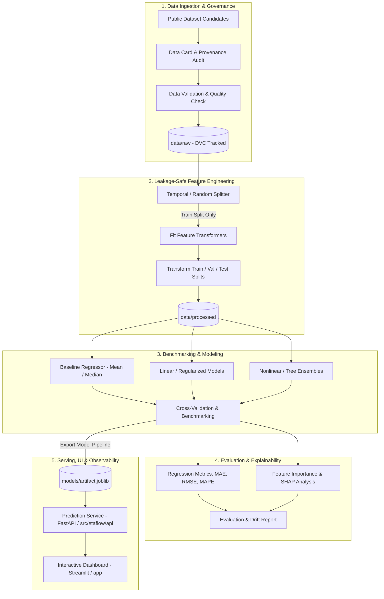

# ETAFlow: End-to-End System Architecture

## 1. System Pipeline Overview

ETAFlow implements a modular, reproducible, production-oriented machine learning architecture designed to predict food delivery durations while enforcing strict data governance and leakage boundaries.

---

## 2. Component Subsystem Responsibilities

### 2.1 Data Management (`src/etaflow/data/` & `data/`)
- **Loader**: Safe file I/O for tabular delivery datasets with schema enforcement.
- **Validation**: Automated verification of missing value percentages, coordinate bounds (latitude/longitude), and categorical cardinality.
- **Storage**: Directory structure separating untracked raw/processed data from Git.

### 2.2 Feature Engineering (`src/etaflow/features/`)
- **Leakage Boundary**: Scikit-Learn style pipeline where all transformers (imputers, scalers, encoders) are fit strictly on the training partition.
- **Feature Extraction**: Haversine/geodesic distance calculations between merchant and customer coordinates, cyclical time encoding (hour of day, day of week), weather/traffic interaction terms.

### 2.3 Modeling & Baselines (`src/etaflow/models/`)
- **Baseline Model**: Simple, non-trivial heuristics (e.g., historical route mean, global mean duration) as the performance floor.
- **Benchmarked Regressors**: Scaled linear models (Ridge/Lasso), gradient-boosted trees, and random forests evaluated under identical validation folds.

### 2.4 Evaluation & Interpretability (`src/etaflow/evaluation/` & `reports/`)
- **Standardized Metrics**: MAE (primary operational metric, minutes), RMSE (penalizes extreme delivery delay outliers), MAPE (relative error).
- **Explainability**: Global feature importances and local SHAP explanations highlighting drivers of high delivery times.

### 2.5 Serving & Application (`src/etaflow/api/` & `app/`)
- **API**: Lightweight inference endpoint with Pydantic request/response validation schemas.
- **Dashboard**: Web UI enabling dispatch operators or customers to simulate delivery routes, inspect predictions, and view feature contributions.
- **Pipelines**: Unified orchestration scripts in `pipelines/` executing the workflow end-to-end.
