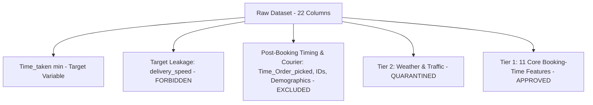

# ETAFlow: Dataset Evaluation & Data Card Specification

## 1. Verified Primary Public Dataset: `zomato_cleaned.csv`

The project has verified and ingested its primary public food delivery dataset: `data/raw/zomato_cleaned.csv` (originating from public Zomato delivery research datasets).

| Dataset Attribute | Specification / Audit Metric | Verification Status |
| :--- | :--- | :---: |
| **File Path** | `data/raw/zomato_cleaned.csv` | 🟢 Read-Only Verified |
| **Git Tracking** | Excluded via `.gitignore` (`*.csv` & `data/raw/*`) | 🟢 Verified Untracked |
| **Total Record Count** | `38,964` rows | 🟢 0 Duplicate Rows |
| **Total Raw Columns** | `22` columns | 🟢 Schema Verified |
| **Primary Target Column** | `Time_taken (min)` (Continuous minutes) | 🟢 0 Missing / Valid Positive |
| **Target Distribution** | Min: `10.0m`, Max: `54.0m`, Mean: `26.58m`, Median: `26.0m` | 🟢 Symmetrical Operational Window |

---

## 2. Feature Availability & Leakage Governance Matrix

All 22 columns have been audited and assigned to strict operational tiers:

### 2.1 Tier 1: Approved Booking-Time Input Features (11 Features)
Genuinely known at the moment of order placement:
* **Spatial (5)**: `distance_km` (Haversine verified), `Restaurant_latitude`, `Restaurant_longitude`, `Delivery_location_latitude`, `Delivery_location_longitude`.
* **Temporal (3)**: `order_hour` (parsed from `Time_Orderd`), `day_of_week` (`0–6` from `Order_Date`), `is_weekend` (`1` if Saturday/Sunday else `0`).
* **Cart & Context (3)**: `Type_of_order` (Snack, Meal, Drinks, Buffet), `Festival` (No, Yes), `City` (Metropolitian, Urban, Semi-Urban).

### 2.2 Tier 2: Availability-Unverified Features (Quarantined)
* **Columns**: `Weather_conditions`, `Road_traffic_density`
* **Policy**: Because public dataset documentation does not guarantee whether weather and traffic were sampled at checkout or during courier transit, they are quarantined from initial model inputs by default (`enabled: false` in `configs/config.yaml`).

### 2.3 Strictly Disallowed Columns (Leakage & Post-Booking)
* `delivery_speed`: Audited as a direct 3-bin discretization of `Time_taken (min)` (`Fast`: 10–19m, `Average`: 20–33m, `Slow`: 34–54m). Severe target leakage.
* `Time_Order_picked`: Measured 5–15 minutes after order confirmation; lookahead timing leakage.
* `Delivery_person_ID`, `Delivery_person_Age`, `Delivery_person_Ratings`: Courier unassigned at checkout.
* `Vehicle_condition`, `Type_of_vehicle`, `multiple_deliveries`: Courier & dynamic dispatch variables.
* `ID`: Arbitrary identifier.

---

## 3. Preprocessing, Split & Data Versioning Specifications

### 3.1 Partition Scheme
* **Split Strategy**: 80% Train, 20% Test (Random Seed = 42).
* **Train Records**: `31,171` rows.
* **Test Records**: `7,793` rows.

### 3.2 Preprocessing Pipeline (`models/preprocessor.joblib`)
* **Numeric Pipeline**: `SimpleImputer(strategy='median')` $\rightarrow$ `StandardScaler()`.
  * Median for missing `order_hour` learned strictly from `X_train` (`median = 18.0`).
* **Categorical Pipeline**: `SimpleImputer(strategy='most_frequent')` $\rightarrow$ `OneHotEncoder(handle_unknown='ignore')`.
* **Transformed Matrix Dimensions**: `17` encoded feature columns ($8$ numeric + $9$ one-hot indicator columns).

### 3.3 Processed Artifacts (CSV)
* `data/processed/train_features.csv` ($31,171 \times 17$)
* `data/processed/train_target.csv` ($31,171 \times 1$)
* `data/processed/test_features.csv` ($7,793 \times 17$)
* `data/processed/test_target.csv` ($7,793 \times 1$)
* `models/preprocessor.joblib` (Fitted preprocessor pipeline)
